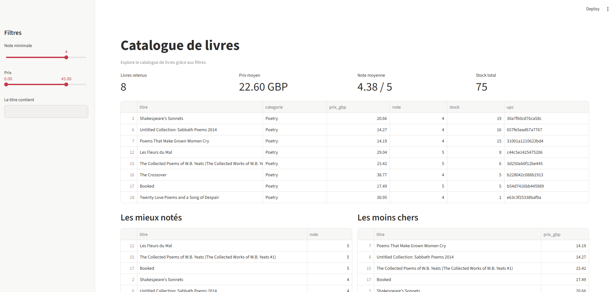
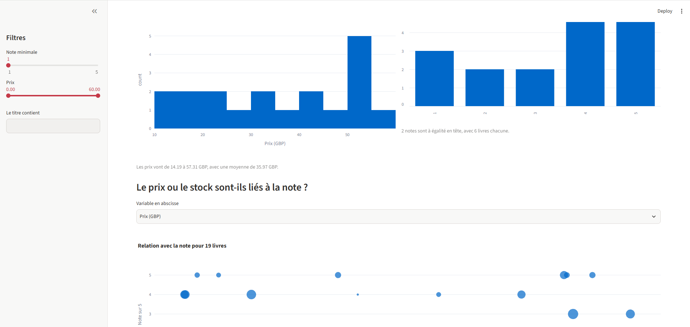

# Explorateur de catalogue de livres

Cette application Streamlit permet d'explorer un catalogue de livres en filtrant par note, par prix et par titre.

Elle affiche quatre indicateurs, le tableau des livres sélectionnés et deux palmarès : les mieux notés et les moins chers.

## Installation

```bash
pip install -r requirements.txt
```

## Lancer l'application

```bash
streamlit run app.py
```

## Aperçu de l'application



## Tableau de bord visuel

Le tableau de bord propose trois graphiques interactifs
sur les prix, les notes et le stock des livres.

Pour le lancer :

```bash
streamlit run dashboard.py
```

